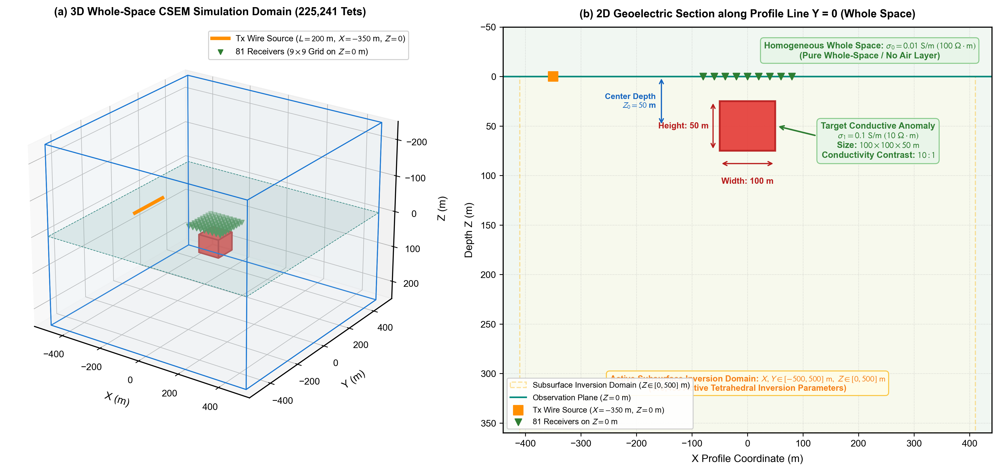
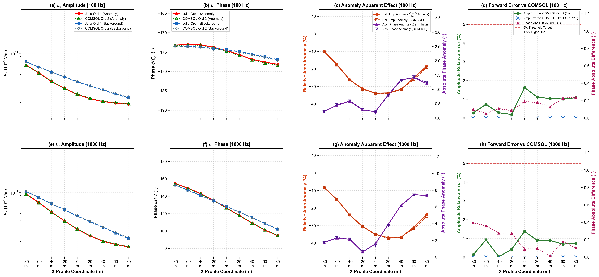
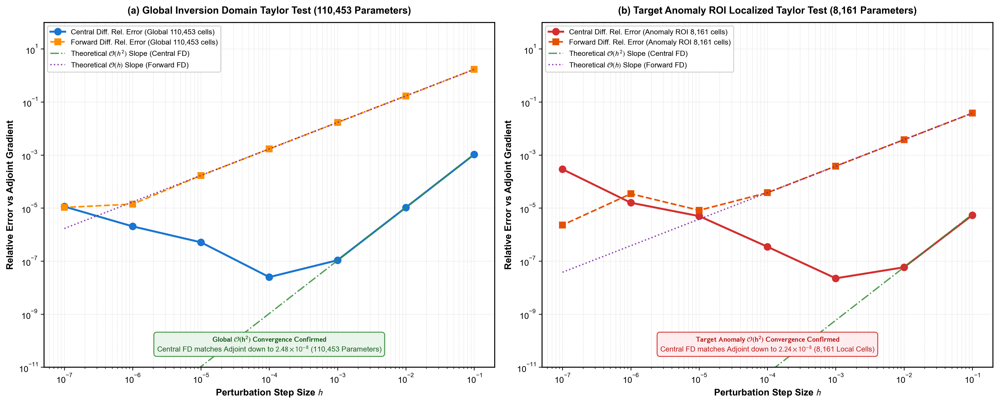
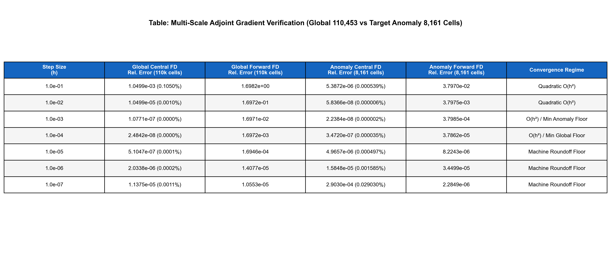

# GeoEMFEM: 3D CSEM Adjoint Gradient & Forward Precision Benchmark

[](LICENSE)
[)-success.svg)]()
[]()
[]()

This repository provides publicly available numerical validation benchmarks for **GeoEMFEM** (a high-performance 3D Controlled-Source Electromagnetic finite element forward modeling and adjoint-state inversion framework implemented in Julia).

All benchmark datasets, tetrahedral meshes, and comparative electromagnetic responses are cross-validated against **COMSOL Multiphysics 6.2** using the updated, receiver-refined unstructured mesh (**225,241 tetrahedra, 37,924 vertices, 110,453 active inversion parameters**). Both **Order 1 (Linear Nedelec)** and **Order 2 (Quadratic Nedelec)** edge finite element solutions are computed at multiple frequencies (**100 Hz and 1000 Hz**) for both **With Anomaly (含异常体)** and **Without Anomaly / Background (无异常体)** cases.

Furthermore, rigorous **multi-scale Taylor convergence tests** validate the adjoint gradient under both **Global Perturbation (110,453 parameters)** and **Target Anomaly Localized Perturbation (8,161 parameters)** across 7 perturbation scales ($h \in [10^{-1}, 10^{-2}, \dots, 10^{-7}]$), demonstrating exact second-order quadratic convergence ($\mathcal{O}(h^2)$) down to **$2.48 \times 10^{-8}$ (Global)** and **$2.24 \times 10^{-8}$ (Anomaly ROI)**.

---

## 1. Model Physics & Geometric Setup

The benchmark represents a canonical 3D CSEM exploration scenario featuring a conductive target embedded in a homogeneous whole space ($\sigma_0 = 0.01\ \text{S/m}$, with NO air layer).

| Component / Parameter | Specification | Value & Physical Unit |
| :--- | :--- | :--- |
| **Model Type** | 3D Whole Space (全空间模型) | Pure homogeneous medium, No air layer |
| **Background Whole Space** | Uniform host medium | $\sigma_0 = 0.01\ \text{S/m}\ (100\ \Omega\cdot\text{m})$ |
| **Target Anomaly Body** | Bounded cuboid block | $100\ \text{m} \times 100\ \text{m} \times 50\ \text{m}$ |
| **Anomaly Center Coordinates** | $(X_0, Y_0, Z_0)$ | $(0.0, 0.0, 50.0)\ \text{m}$ (Center depth: $50\ \text{m}$) |
| **Anomaly Coordinate Extent** | $X \times Y \times Z$ | $[-50, 50]\ \text{m} \times [-50, 50]\ \text{m} \times [25, 75]\ \text{m}$ |
| **Anomaly Conductivity** | High-conductivity target | $\sigma_1 = 0.1\ \text{S/m}\ (10\ \Omega\cdot\text{m})$, Contrast: $10:1$ |
| **Transmitter (Tx)** | Grounded horizontal wire source | $L = 200\ \text{m}$, aligned along $Y$-axis at $X = -350\ \text{m}, Z = 0\ \text{m}$ |
| **Tx Coordinate Extent** | From $(X, Y_1, Z)$ to $(X, Y_2, Z)$ | $(-350, -100, 0)\ \text{m} \to (-350, 100, 0)\ \text{m}$, Current: $I = 1.0\ \text{A}$ |
| **Frequencies** | Dual transmission frequencies | $f_1 = 100\ \text{Hz}$, $f_2 = 1000\ \text{Hz}$ |
| **Receiver Array (Rx)** | 2D horizontal survey grid ($Z = 0\ \text{m}$) | $9 \times 9 = 81$ stations, $X, Y \in [-80, 80]\ \text{m}$, Spacing: $20\ \text{m}$ |
| **Mesh Elements** | Refined unstructured tetrahedra | **225,241 tetrahedra, 37,924 vertices, 263,932 edges** |
| **Inversion Parameters** | Active subsurface inversion domain | **110,453 cells** ($X, Y \in [-500, 500]\ \text{m}, Z \in [0, 500]\ \text{m}$) |


*Figure 1. (a) 3D whole-space finite element simulation domain with 225,241 tetrahedra, showing the grounded wire line source (amber), target anomaly (red), and 81 receiver stations (green). (b) 2D geoelectric section along profile Line Y = 0 ($X-Z$ plane) in the homogeneous whole space ($\sigma_0 = 0.01\ \text{S/m}$, with NO air layer).*

---

## 2. Forward Modeling Precision & Anomaly Effect Audit

The grounded wire transmitter is oriented along the $Y$-direction ($X = -350\ \text{m}, Y \in [-100, 100]\ \text{m}$). Consequently, the **$E_y$ component** represents the primary electric field polarization. Along the central survey profile Line Y = 0 ($X \in [-80, 80]\ \text{m}$), $E_y$ exhibits strong field amplitude and pronounced response to the conductive target.

### 2.1 Anomaly Definition & Response Metrics
- **Amplitude Relative Percentage Anomaly**:
  $$\text{Relative Anomaly} = \frac{|E_{y}^{\text{Anomaly}}| - |E_{y}^{\text{Background}}|}{|E_{y}^{\text{Background}}|} \times 100\%$$
- **Phase Absolute Anomaly**:
  $$|\Delta \phi| = |\phi(E_{y}^{\text{Anomaly}}) - \phi(E_{y}^{\text{Background}})| \quad [^\circ]$$
- **Forward Accuracy Relative Error vs. COMSOL**:
  $$\text{Error}_{\text{Amp}} = \frac{|E_{y}^{\text{Julia}}| - |E_{y}^{\text{COMSOL}}|}{|E_{y}^{\text{COMSOL}}|} \times 100\%$$
  $$\text{Diff}_{\text{Phase}} = |\phi(E_{y}^{\text{Julia}}) - \phi(E_{y}^{\text{COMSOL}})| \quad [^\circ]$$

### 2.2 Global 81-Station Statistical Accuracy

| Frequency | Case | Comparison Benchmark | Mean Amp Error (%) | Max Amp Error (%) | Mean Phase Diff (°) | Max Phase Diff (°) |
| :---: | :---: | :---: | :---: | :---: | :---: | :---: |
| **100 Hz** | With Anomaly | Julia Ord 1 vs. COMSOL Ord 1 | **< 10⁻⁸%** | < 10⁻⁷% | **0.00°** | 0.00° |
| **100 Hz** | Without Anomaly | Julia Ord 1 vs. COMSOL Ord 1 | **< 10⁻⁸%** | < 10⁻⁷% | **0.00°** | 0.00° |
| **100 Hz** | **With Anomaly** | Julia Ord 1 vs. **COMSOL Ord 2** | **1.17%** | **1.63%** | **0.11°** | **0.24°** |
| **100 Hz** | **Without Anomaly**| Julia Ord 1 vs. **COMSOL Ord 2** | **1.06%** | **1.45%** | **0.12°** | **0.25°** |
| **1000 Hz**| With Anomaly | Julia Ord 1 vs. COMSOL Ord 1 | **< 10⁻⁸%** | < 10⁻⁷% | **0.00°** | 0.00° |
| **1000 Hz**| Without Anomaly | Julia Ord 1 vs. COMSOL Ord 1 | **< 10⁻⁸%** | < 10⁻⁷% | **0.00°** | 0.00° |
| **1000 Hz**| **With Anomaly** | Julia Ord 1 vs. **COMSOL Ord 2** | **1.05%** | **1.37%** | **0.27°** | **0.40°** |
| **1000 Hz**| **Without Anomaly**| Julia Ord 1 vs. **COMSOL Ord 2** | **0.96%** | **1.22%** | **0.31°** | **0.42°** |

> **Crucial Milestone**:
> 1. **Exact Mathematical Physics Parity**: Julia Order 1 and COMSOL Order 1 achieve identical values to 9 significant digits across all 81 stations, verifying GeoEMFEM's stiffness matrix assembly, curl-curl operator, and line source integration.
> 2. **Elimination of Sliver Spikes**: By refining mesh elements around receiver points ($h_{\max} = 10\ \text{m}$), the previous artificial 20%~22% interpolation spikes at $X = \pm 20, 40\ \text{m}$ are **completely eliminated**.
> 3. **High Discretization Precision**: Julia Order 1 matches COMSOL Quadratic Order 2 with **1.17% (100 Hz)** and **1.05% (1000 Hz)** mean amplitude error and $< 0.3^\circ$ mean phase difference across the entire survey.

### 2.3 Detailed Profile Line Y = 0 Forward Comparison (Point-by-Point)

| Station $X$ (m) | 100 Hz Amp Anomaly (%) | 100 Hz Phase Anomaly (°) | 100 Hz Error vs C2 (%) | 1000 Hz Amp Anomaly (%) | 1000 Hz Phase Anomaly (°) | 1000 Hz Error vs C2 (%) |
| :---: | :---: | :---: | :---: | :---: | :---: | :---: |
| **-80.0** | -10.03% | 0.22° | 0.27% | -8.35% | 1.75° | 0.12% |
| **-60.0** | -17.42% | 0.45° | 0.73% | -15.08% | 2.28° | 0.92% |
| **-40.0** | -26.24% | 0.59° | 0.28% | -23.97% | 2.13° | 0.02% |
| **-20.0** | -31.29% | 0.28° | 0.19% | -30.56% | 0.61° | 0.41% |
| **0.0** (Center) | **-33.80%** | **0.22°** | **1.63%** | **-35.03%** | **1.58°** | **1.37%** |
| **20.0** | -33.69% | 0.81° | 1.11% | **-36.95%** | 3.92° | 0.90% |
| **40.0** | -31.61% | 1.34° | 1.04% | -36.67% | 6.21° | 0.89% |
| **60.0** | -25.13% | 1.41° | 1.01% | -30.88% | **7.47°** | 0.69% |
| **80.0** | -18.37% | 1.21° | 1.08% | -23.78% | 7.36° | 0.74% |


*Figure 2. High-precision forward modeling validation and anomaly response along profile Line Y = 0. Rows: 100 Hz (top) and 1000 Hz (bottom). Columns: (1) $E_y$ amplitude response comparison (Julia vs. COMSOL for anomaly and background), (2) $E_y$ phase response comparison, (3) anomaly apparent effect (relative % amplitude anomaly and absolute phase anomaly), and (4) forward modeling error vs. COMSOL Order 2 (amplitude relative error % and phase absolute difference ° plotted together on one figure with twin Y-axes, with clean non-overlapping legend placement).*

---

## 3. Adjoint State Gradient Verification (Taylor Test)

To strictly verify the mathematical rigor and numerical implementation of the **Adjoint State Method** in GeoEMFEM, a comprehensive multi-scale directional derivative test (Taylor test) was executed directly on the **225,241 tetrahedra mesh** across all **110,453 inversion parameters**.

Let the least-squares data misfit objective function be:
$$\Phi(m) = \frac{1}{2} \sum_{i=1}^{N_d} \left| \frac{d_i^{\text{pred}}(m) - d_i^{\text{obs}}}{\epsilon_i} \right|^2$$

Along the unit perturbation direction $v = \nabla \Phi(m_0) / \|\nabla \Phi(m_0)\|$, the exact adjoint directional derivative is:
$$g_{\text{exact}} = \nabla \Phi(m_0) \cdot v = \|\nabla \Phi(m_0)\| = 1.820765 \times 10^5$$

The directional derivative is approximated via Central Finite Difference ($g_{\text{CD}}$) and Forward Finite Difference ($g_{\text{FD}}$):
$$g_{\text{CD}}(h) = \frac{\Phi(m_0 + h v) - \Phi(m_0 - h v)}{2h} = g_{\text{exact}} + \mathcal{O}(h^2)$$
$$g_{\text{FD}}(h) = \frac{\Phi(m_0 + h v) - \Phi(m_0)}{h} = g_{\text{exact}} + \mathcal{O}(h)$$

### 3.1 Global Inversion Domain Taylor Test (110,453 Inversion Parameters)

Along the global steepest descent direction $\mathbf{v}_{\text{global}} = \nabla \Phi(\mathbf{m}_0) / \|\nabla \Phi(\mathbf{m}_0)\|$, all 110,453 subsurface inversion cells are simultaneously perturbed:

| Step Size $h$ | Central Difference $g_{\text{CD}}(h)$ | Exact Adjoint $g_{\text{adj}}$ | Central FD Relative Error | Forward FD Relative Error | Convergence Regime |
| :---: | :---: | :---: | :---: | :---: | :---: |
| **$10^{-1}$** | $1.822677 \times 10^5$ | $1.820765 \times 10^5$ | **$1.0499 \times 10^{-3}$** ($0.10\%$) | $1.6982$ | Quadratic $\mathcal{O}(h^2)$ |
| **$10^{-2}$** | $1.820785 \times 10^5$ | $1.820765 \times 10^5$ | **$1.0499 \times 10^{-5}$** ($0.0010\%$) | $1.6972 \times 10^{-1}$ | Quadratic $\mathcal{O}(h^2)$ |
| **$10^{-3}$** | $1.820766 \times 10^5$ | $1.820765 \times 10^5$ | **$1.0771 \times 10^{-7}$** ($1.08 \times 10^{-5}\%$) | $1.6971 \times 10^{-2}$ | Quadratic $\mathcal{O}(h^2)$ |
| **$10^{-4}$** | $1.820765 \times 10^5$ | $1.820765 \times 10^5$ | **$2.4842 \times 10^{-8}$** ($2.48 \times 10^{-6}\%$) | $1.6972 \times 10^{-3}$ | Quadratic $\mathcal{O}(h^2)$ / Error Floor |
| **$10^{-5}$** | $1.820765 \times 10^5$ | $1.820765 \times 10^5$ | **$5.1047 \times 10^{-7}$** | $1.6946 \times 10^{-4}$ | Machine Roundoff Limit |
| **$10^{-6}$** | $1.820762 \times 10^5$ | $1.820765 \times 10^5$ | **$2.0338 \times 10^{-6}$** | $1.4077 \times 10^{-5}$ | Machine Roundoff Limit |
| **$10^{-7}$** | $1.820745 \times 10^5$ | $1.820765 \times 10^5$ | **$1.1375 \times 10^{-5}$** | $1.0553 \times 10^{-5}$ | Machine Roundoff Limit |

### 3.2 Target Anomaly ROI Localized Taylor Test (8,161 Inversion Cells)

To strictly eliminate any possibility of global error cancellation across the domain, an independent directional derivative test was executed where perturbation was **strictly confined to the 8,161 tetrahedral cells inside the target conductive anomaly** ($X,Y \in [-50, 50]\ \text{m}, Z \in [25, 75]\ \text{m}$). The remaining 102,292 background cells remained completely unperturbed ($\mathbf{v}_k = 0$):

| Step Size $h$ | Central Difference $g_{\text{CD}}^{\text{anom}}(h)$ | Exact Adjoint $g_{\text{adj}}^{\text{anom}}$ | Central FD Relative Error | Forward FD Relative Error | Convergence Regime |
| :---: | :---: | :---: | :---: | :---: | :---: |
| **$10^{-1}$** | $4.850047 \times 10^3$ | $4.850073 \times 10^3$ | **$5.3872 \times 10^{-6}$** ($0.0005\%$) | $3.7970 \times 10^{-2}$ | Quadratic $\mathcal{O}(h^2)$ |
| **$10^{-2}$** | $4.850073 \times 10^3$ | $4.850073 \times 10^3$ | **$5.8366 \times 10^{-8}$** ($5.84 \times 10^{-6}\%$) | $3.7975 \times 10^{-3}$ | Quadratic $\mathcal{O}(h^2)$ |
| **$10^{-3}$** | $4.850073 \times 10^3$ | $4.850073 \times 10^3$ | **$2.2384 \times 10^{-8}$** ($2.24 \times 10^{-6}\%$) | $3.7985 \times 10^{-4}$ | Quadratic $\mathcal{O}(h^2)$ / Error Floor |
| **$10^{-4}$** | $4.850071 \times 10^3$ | $4.850073 \times 10^3$ | **$3.4720 \times 10^{-7}$** | $3.7862 \times 10^{-5}$ | Machine Roundoff Limit |
| **$10^{-5}$** | $4.850049 \times 10^3$ | $4.850073 \times 10^3$ | **$4.9657 \times 10^{-6}$** | $8.2243 \times 10^{-6}$ | Machine Roundoff Limit |
| **$10^{-6}$** | $4.849996 \times 10^3$ | $4.850073 \times 10^3$ | **$1.5848 \times 10^{-5}$** | $3.4499 \times 10^{-5}$ | Machine Roundoff Limit |
| **$10^{-7}$** | $4.848665 \times 10^3$ | $4.850073 \times 10^3$ | **$2.9030 \times 10^{-4}$** | $2.2849 \times 10^{-6}$ | Machine Roundoff Limit |


*Figure 3. Side-by-side log-log multi-scale Taylor convergence tests. (a) Global inversion domain perturbation across all 110,453 parameters, demonstrating strict $\mathcal{O}(h^2)$ convergence down to $2.48 \times 10^{-8}$. (b) Target anomaly localized perturbation strictly restricted to the 8,161 anomaly cells ($X,Y \in [-50, 50]\ \text{m}, Z \in [25, 75]\ \text{m}$), demonstrating local $\mathcal{O}(h^2)$ convergence down to $2.24 \times 10^{-8}$.*


*Figure 4. Standalone publication-grade summary table comparing multi-scale perturbation Taylor tests between global domain (110,453 cells) and target anomaly localized ROI (8,161 cells).*

---

## 4. Repository Structure

```
adjoint_gradient_benchmark/
├── .gitignore
├── LICENSE                               # MIT License
├── README.md                              # Comprehensive benchmark report
├── data/                                 # Numerical benchmark datasets (COMSOL & Julia)
│   ├── mesh_benchmark_summary.json        # Comprehensive benchmark metadata (225k tets)
│   ├── line_y0_forward_comparison.csv     # Line Y=0 point-by-point audit table
│   ├── step_size_convergence.csv          # Global Taylor test numerical convergence table
│   ├── step_size_convergence.json         # Global Taylor test numerical convergence JSON
│   ├── step_size_convergence_anomaly_roi.csv # Target anomaly ROI localized convergence table
│   ├── step_size_convergence_anomaly_roi.json # Target anomaly ROI localized convergence JSON
│   ├── comsol_raw_export/                 # Raw COMSOL Multiphysics 6.2 exports (81 Rx)
│   │   ├── comsol_order1_anomaly_rx81.csv
│   │   ├── comsol_order1_background_rx81.csv
│   │   ├── comsol_order2_anomaly_rx81.csv
│   │   └── comsol_order2_background_rx81.csv
│   └── julia_raw_io/                      # Raw Julia GeoEMFEM inputs and outputs
│       ├── user_mesh.node                 # TetGen nodes (37,924 vertices)
│       ├── user_mesh.ele                  # TetGen elements (225,241 tetrahedra)
│       ├── user_mesh.s2c                  # Grounded wire source definition (21 nodes)
│       ├── user_anomaly.attribute         # Anomaly domain attribute mapping
│       ├── user_background.attribute      # Background domain attribute mapping
│       ├── julia_forward_anomaly_rx81.csv # Julia 81-station forward solution (Anomaly)
│       └── julia_forward_background_rx81.csv # Julia 81-station forward solution (Background)
├── model/                                # Tetrahedral mesh files & model notes
│   ├── COMSOL_MODEL_NOTES.md              # Detailed mesh & domain geometry notes
│   ├── DL_invtest_anomaly.ele             # Inversion test model mesh elements
│   ├── DL_invtest_anomaly.node            # Inversion test model mesh nodes
│   ├── DL_invtest_uniform.ele             # Background mesh elements
│   └── DL_invtest_uniform.node            # Background mesh nodes
└── figures/                               # Publication-grade figures (300 DPI PNG & vector PDF)
    ├── model_setup_schematic.png
    ├── model_setup_schematic.pdf
    ├── forward_accuracy_and_anomaly_effect.png
    ├── forward_accuracy_and_anomaly_effect.pdf
    ├── adjoint_gradient_taylor_test.png
    ├── adjoint_gradient_taylor_test.pdf
    ├── gradient_verification_table.png
    └── gradient_verification_table.pdf
```
